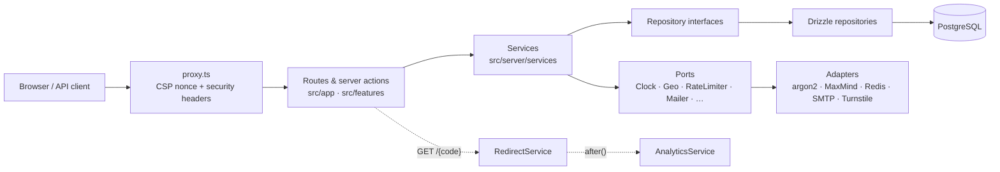

<div align="center">


# Vialb

**A modern, open-source URL shortener with privacy-friendly analytics and custom QR codes.**

[](https://github.com/RaydanAridiCS/vialb.link/actions/workflows/ci.yml)
[](https://github.com/RaydanAridiCS/vialb.link/actions/workflows/codeql.yml)
[](LICENSE)

[Features](#features) · [Local development](#local-development) · [Architecture](docs/architecture.md) · [Contributing](CONTRIBUTING.md)

</div>

---

<!-- Screenshots: run `npm run seed`, sign in as demo@vialb.local, then capture these pages. -->

|       Landing page       |      Link analytics      |     Links dashboard      |
| :----------------------: | :----------------------: | :----------------------: |
| _screenshot coming soon_ | _screenshot coming soon_ | _screenshot coming soon_ |

## Features

- 🔗 **Short links**: random codes (crypto-secure nanoid, no look-alike characters) or custom case-sensitive codes
- ⏳ **Expiry & access limits**: presets or custom dates; visit limits enforced atomically in the database
- 🔒 **Password protection**: argon2id, rate-limited unlock page; link-preview bots never see the destination
- 🖼️ **Link previews**: custom Open Graph title, description and image for Slack, Discord, X, WhatsApp…
- 📊 **Analytics without tracking**: clicks over time, weekday × hour heatmap, countries & cities, devices, browsers, OS, referrers, UTM campaigns, languages, bot filtering, CSV export. Raw IPs are never stored.
- 🧾 **QR codes**: PNG/SVG (and high-res PNG) on demand with your colours, error-correction level and an optional "Scan me" badge frame; warns about codes that will not scan ([details](docs/import-and-qr.md#qr-codes))
- 🧰 **Dashboard**: search, filters, sorting, bulk disable/delete/export, edit everything except the code
- 🏷️ **Tags**: label links (`promo`, `client-work`) and filter the dashboard by tag, also via the API
- 🎯 **UTM builder**: add `utm_*` campaign parameters to a destination with presets and a live preview
- 📥 **CSV import**: bring hundreds of links over from Bitly, TinyURL or a spreadsheet with column detection, a preview, per-row errors and a downloadable error file ([details](docs/import-and-qr.md#csv-import))
- 🧑‍🎤 **Link-in-bio pages**: a public page at `/@handle` with your picture, bio, social icons and buttons; every button click is counted like a link ([details](docs/link-in-bio.md))
- 🧭 **Smart routing**: one link, different destinations by device (iPhone, Android, desktop) and country, with analytics on which rule fired ([details](docs/smart-routing.md))
- 🖼️ **Social card studio**: design the preview image for shared links without uploading anything, and see mock-ups for WhatsApp, iMessage, Slack and X ([details](docs/social-cards.md))
- 🎯 **Retargeting pixels**: send visitors through a consent page that runs your Meta Pixel or Google tag before forwarding them; off by default, honours Global Privacy Control ([details](docs/retargeting-pixels.md))
- 👥 **Teams**: shared workspaces with owner, admin, editor and viewer roles, email invitations, and API keys that act in their workspace ([details](docs/teams.md))
- 🔑 **REST API**: API keys, per-key rate limits, OpenAPI 3.1 + interactive docs
- 👥 **Accounts**: email/password, optional GitHub & Google, TOTP 2FA with backup codes, data export, account deletion
- 🛡️ **Admin**: instance settings, user roles and bans, every link on the instance, stats
- 🕶️ **Anonymous links (optional)**: forced lifetime, stricter rate limits, Cloudflare Turnstile, claim them after sign-up
- 🚫 **Anti-abuse**: domain blocklist, optional Google Safe Browsing, self-link protection
- 🌗 **Polished UI**: responsive, accessible, light/dark/system themes
- 🐳 **Easy to run**: one Docker image (amd64/arm64), migrations on start, health checks

## Quick start

```bash
git clone https://github.com/RaydanAridiCS/vialb.link.git && cd vialb.link
cp .env.example .env    # set SITE_URL and BETTER_AUTH_SECRET (openssl rand -base64 32)
docker compose up -d    # → http://localhost:3000
```

Sign up: **the first account becomes the administrator**. See the
[self-hosting guide](docs/self-hosting.md) for reverse proxies (Caddy, nginx),
Coolify/Dokploy, GeoLite2, backups and upgrades.

## Local development

```bash
npm install
cp .env.example .env
docker compose -f docker-compose.dev.yml up -d   # PostgreSQL 17
npm run db:migrate
npm run seed        # optional demo data → demo@vialb.local / demo-password-123
npm run dev
```

Everything else (tests, scripts, conventions) is in [CONTRIBUTING.md](CONTRIBUTING.md).

## Configuration

The most important variables (all of them are in [docs/configuration.md](docs/configuration.md) and [`.env.example`](.env.example)):

| Variable                                             | Default       | Description                                                   |
| ---------------------------------------------------- | ------------- | ------------------------------------------------------------- |
| `SITE_URL`                                           | —             | Public base URL; every absolute URL is built from it          |
| `DATABASE_URL`                                       | —             | PostgreSQL connection string                                  |
| `BETTER_AUTH_SECRET`                                 | —             | ≥ 32 random characters                                        |
| `ALLOW_SIGNUPS`                                      | `true`        | Allow new accounts (overridable in the admin UI)              |
| `ALLOW_ANONYMOUS_LINKS`                              | `false`       | Shorten without an account (overridable)                      |
| `PIXELS_ENABLED`                                     | `false`       | Allow Meta / Google retargeting pixels on links (overridable) |
| `ANON_LINK_TTL_HOURS`                                | `720`         | Lifetime of anonymous links                                   |
| `REDIRECT_STATUS`                                    | `302`         | `302` or `307` (never permanent)                              |
| `FORWARD_QUERY_PARAMS`                               | `true`        | Pass `?utm_*` etc. through to the destination                 |
| `TRUST_PROXY` / `TRUSTED_PROXY_HOPS`                 | `false` / `1` | Read the client IP from `X-Forwarded-For` behind a proxy      |
| `GEOLITE2_DB_PATH`                                   | —             | Local MaxMind database for country/city analytics             |
| `TRUST_PROXY_GEO_HEADERS`                            | `false`       | Use CDN geo headers (Cloudflare, Vercel, CloudFront)          |
| `REDIS_URL`                                          | —             | Shared rate limits across replicas                            |
| `GITHUB_CLIENT_ID/SECRET`, `GOOGLE_CLIENT_ID/SECRET` | —             | Optional OAuth sign-in                                        |
| `SMTP_*`                                             | —             | Password reset & verification emails                          |
| `TURNSTILE_SITE_KEY/SECRET_KEY`                      | —             | Captcha for anonymous links                                   |
| `SAFE_BROWSING_API_KEY`                              | —             | Google Safe Browsing check on creation                        |

## API

Create a key in **Dashboard → API keys**, then:

```bash
curl -X POST https://go.example.com/api/v1/links \
  -H "Authorization: Bearer tw_your_key" \
  -H "Content-Type: application/json" \
  -d '{"url":"https://example.com/a/very/long/path","code":"launch","maxClicks":100}'
```

```json
{
  "id": "0199…",
  "code": "launch",
  "shortUrl": "https://go.example.com/launch",
  "status": "active",
  "clickCount": 0,
  "…": "…"
}
```

Interactive reference at `/docs/api`, OpenAPI document at `/api/v1/openapi.json`,
and more examples in [docs/api.md](docs/api.md). Tags and the UTM builder are described in
[docs/link-organization.md](docs/link-organization.md).

## Tech stack

| Area               | Choice                                                                                                                         |
| ------------------ | ------------------------------------------------------------------------------------------------------------------------------ |
| Framework          | [Next.js 16](https://nextjs.org) (App Router, Server Actions, Route Handlers, `proxy.ts`), React 19, TypeScript (strict)       |
| UI                 | Tailwind CSS v4, [shadcn/ui](https://ui.shadcn.com) (New York), lucide-react, next-themes, sonner, Recharts, TanStack Table v9 |
| Data               | PostgreSQL 17, [Drizzle ORM](https://orm.drizzle.team) + committed SQL migrations, postgres.js                                 |
| Auth               | [Better Auth](https://www.better-auth.com): email/password, OAuth, TOTP 2FA, admin plugin                                      |
| Validation         | zod (shared client/server schemas), react-hook-form, next-safe-action                                                          |
| Security & privacy | argon2id, nonce-based CSP, hashed visitor IDs, rate limiting (memory/Redis), Turnstile, Safe Browsing                          |
| API docs           | OpenAPI 3.1 via zod-to-openapi, Scalar                                                                                         |
| Testing            | Vitest (unit + Testcontainers integration), Playwright (E2E), Testing Library                                                  |
| Tooling            | ESLint (flat, typescript-eslint strict), Prettier, lefthook, lint-staged, commitlint, release-please                           |
| Delivery           | Multi-stage Docker image (non-root, standalone), Docker Compose, GHCR, GitHub Actions, CodeQL, Dependabot                      |

## Architecture



Routes stay thin, services hold the business rules (and authorization), and only
the Drizzle repositories touch SQL. Details, the redirect decision flow, the data
model and the security model are in [docs/architecture.md](docs/architecture.md).

## Roadmap

See [ROADMAP.md](ROADMAP.md). Next up: CSV import, webhooks and custom domains.

## Contributing

Issues and pull requests are welcome. Please read [CONTRIBUTING.md](CONTRIBUTING.md)
and the [Code of Conduct](CODE_OF_CONDUCT.md). Report security issues privately as
described in [SECURITY.md](SECURITY.md).

## License

[MIT](LICENSE) © 2026 Raydan Aridi
