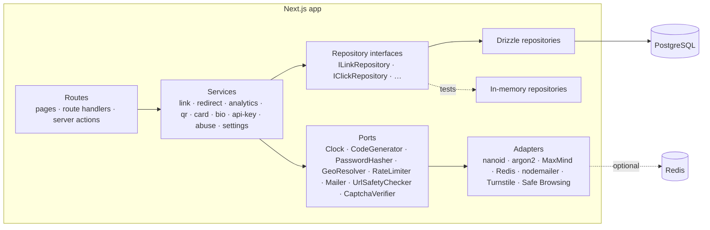
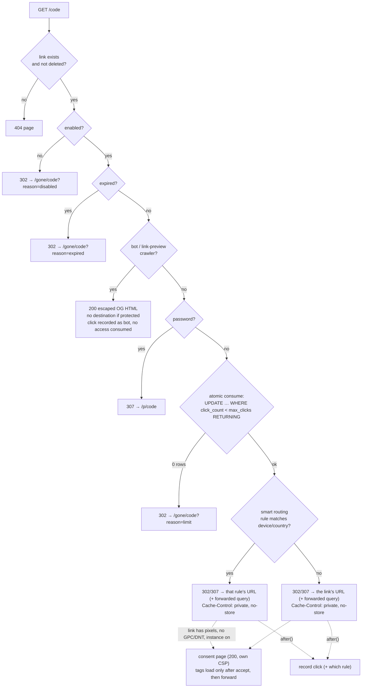
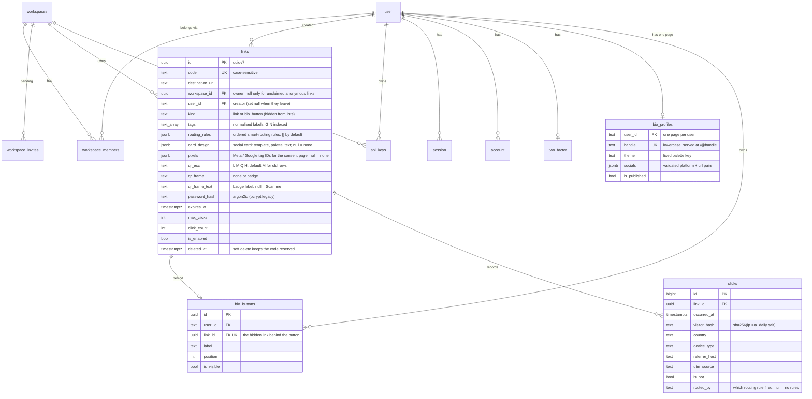

# Architecture

Vialb is a single Next.js 16 application (App Router) backed by
PostgreSQL. It follows a **repository pattern + service layer** so business
rules live in plain TypeScript classes that are easy to test without a
database or a framework.

## Layers and rules

| Layer                 | Location                                  | May depend on                                                                    |
| --------------------- | ----------------------------------------- | -------------------------------------------------------------------------------- |
| Routes (thin)         | `src/app/**`, `src/features/*/actions.ts` | services (via `getContainer()`), shared zod schemas                              |
| Services              | `src/server/services/*`                   | repository **interfaces**, ports, domain types, pure helpers in `src/server/lib` |
| Repository interfaces | `src/server/repositories/*.repository.ts` | domain types                                                                     |
| Drizzle repositories  | `src/server/repositories/drizzle/*`       | Drizzle, the schema                                                              |
| Ports / adapters      | `src/server/ports`, `src/server/adapters` | external libraries                                                               |
| Composition root      | `src/server/container.ts`                 | everything (wires concrete implementations once per process)                     |

- **Only** `src/server/repositories/drizzle/*`, `src/server/db/*` and `src/server/auth/*`
  import Drizzle. This is enforced by an ESLint `no-restricted-imports` rule.
- Services receive dependencies through their constructor. Unit tests build them
  with in-memory fakes (`tests/support/fixtures.ts`); production uses `container.ts`.
- Authorization (owner or admin) is checked **inside services**, never only in the UI.
- Domain errors (`src/server/errors.ts`) are mapped to HTTP statuses in exactly one
  place: `src/server/http/error-mapper.ts`.
- Every server action goes through `next-safe-action` clients defined in
  `src/server/http/safe-action.ts` (`publicActionClient`, `authActionClient`,
  `adminActionClient`), which resolve the session and validate input with zod.
- Zod schemas in `src/features/*/schemas.ts` are shared by forms (client) and
  actions/API (server). The REST API schemas (`api-schemas.ts`) reuse the same
  field validators and generate the OpenAPI document.

> Next.js may bundle a module into more than one server chunk. Domain errors are
> therefore branded with `Symbol.for(...)` and override `Symbol.hasInstance`, so
> `instanceof` works no matter which copy created the error.

### Adding a repository or service

1. Define the interface in `src/server/repositories/<name>.repository.ts` using
   domain types from `src/server/domain/types.ts`.
2. Implement it in `src/server/repositories/drizzle/<name>.repository.drizzle.ts`
   (+ an in-memory fake in `src/server/repositories/in-memory/` for unit tests).
3. Write the service in `src/server/services/<name>.service.ts`, depending only on
   interfaces and ports. Throw domain errors, never HTTP responses.
4. Wire both in `src/server/container.ts` and add them to `tests/support/fixtures.ts`.
5. Add unit tests (service + in-memory fake) and integration tests for the Drizzle
   implementation (`tests/integration`, real Postgres via Testcontainers).

## The redirect hot path

`GET /{code}` is a route handler (`src/app/[code]/route.ts`) calling
`RedirectService.resolve`. The order of checks is deliberate:

- Short links never use 301/308: browsers would cache them and expiry,
  limits, disabling and analytics would silently stop working.
- The click is written with Next's `after()` once the response is sent; failures
  are logged, never surfaced to the visitor.
- `HEAD` requests (link checkers) are answered without consuming access.

## Data model

Tags are a plain `text[]` on `links` (no join table): one owner, small lists, filtered
with `tags @> ARRAY[tag]` through a GIN index. See
[Organizing and tracking links](link-organization.md) for tags and the UTM builder.

QR design (`qr_fg_color`, `qr_bg_color`, `qr_ecc`, `qr_frame`, `qr_frame_text`) lives on the link
too, as plain typed columns. QR images themselves are never stored: `QrService` draws them on
demand with the shared composer in `src/lib/qr-svg.ts`. See
[CSV import and QR codes](import-and-qr.md) for the import flow and the QR options.

Smart routing rules and the social card design are plain `jsonb` columns on `links`: they are read together
with the link on the redirect path and always edited as a whole, so a join table would only add queries.
Rules are matched by pure code in `src/lib/routing.ts`; the redirect service looks the visitor's country up
(locally, never over the network) only when a rule has countries. See [Smart routing](smart-routing.md)
and [Social card studio](social-cards.md).

Bio pages (`/@handle`) are one `bio_profiles` row per user plus ordered `bio_buttons`. Each button owns a
hidden `links` row (`kind = 'bio_button'`), which is why clicks, limits and analytics need no special
casing; `kind` only keeps those rows out of the normal lists. See [Link-in-bio pages](link-in-bio.md).

Links and API keys belong to a **workspace** (`workspaces`, `workspace_members(role)`, `workspace_invites`).
Everyone has a personal workspace, created the first time they sign in; teams are extra workspaces. Who may touch
a link is decided in one place, `assertCanManageLink`, from the actor's workspace role (`src/lib/permissions.ts`).
`links.user_id` is only the creator. See [Teams](teams.md).

Scheduled work runs in-process ([Background jobs](jobs.md)): `job_runs` holds each job's lease, `link_health`
the latest destination check of a link ([Link health](link-health.md)), `email_deliveries` the idempotency ledger
for scheduled emails and `user_preferences` the per-person opt-outs ([Reports](reports.md)). `links.stats_token`
is the opt-in [public stats](public-stats.md) address.

Plus `instance_settings` (single row of admin overrides on top of env
defaults), `daily_salts` (one random salt per UTC day) and Better Auth's tables.
Migrations are committed SQL in `src/server/db/migrations` (generated with
`drizzle-kit generate`, never `push`).

## Rendering model

Next.js 16 enables **Cache Components** by default; Vialb turns it off
(`next.config.ts`). The app sets a strict, nonce-based Content Security Policy in
`src/proxy.ts`, and nonces require every HTML page to be rendered per request.
Almost every page is user-specific anyway (dashboard, analytics, settings), so
static shells would bring little benefit. The root layout reads the nonce and
passes it to `next-themes`; Next.js applies it to its own scripts automatically.

## Security model

- **Destinations**: only `http:`/`https:`; no embedded credentials; links back to
  the instance itself are rejected; admin-managed domain blocklist; optional Google
  Safe Browsing check at creation/edit time.
- **Bot previews** are minimal HTML with every value escaped, no scripts, no
  meta-refresh and their own `default-src 'none'` CSP. A protected link's
  destination is never included.
- **Passwords**: argon2id (OWASP parameters). Legacy bcrypt hashes are verified and
  upgraded transparently. Unlock attempts are rate limited per (IP, code) and per code;
  unknown codes still spend hashing time.
- **Access limits** are enforced by a single `UPDATE … RETURNING` statement, so
  concurrent visitors can never exceed the limit (covered by an integration test
  with 50 parallel consumers).
- **Privacy**: raw IPs are never stored. Visitors are identified by
  `sha256(ip + userAgent + dailySalt)`; salts rotate daily and live in the database.
  Geolocation uses CDN headers or a local GeoLite2 database — never a third-party API.
  Referrer query strings are dropped.
- **Client IP**: taken from `X-Forwarded-For`, read from the right, only when
  `TRUST_PROXY=true` (skipping `TRUSTED_PROXY_HOPS - 1` entries). Without a trusted
  proxy, Next.js only exposes the socket address through the same header, so
  deploy behind a reverse proxy in production.
- **Headers**: nonce-based CSP (`strict-dynamic`), `frame-ancestors 'none'`,
  `X-Frame-Options: DENY`, `nosniff`, `Permissions-Policy`, HSTS on https.
- **Auth**: Better Auth sessions (httpOnly cookies), built-in auth rate limiting,
  TOTP 2FA, admin bans that also disable the user's API keys.
- **CSRF**: server actions check the request origin; the REST API accepts only
  Bearer API keys (no cookies).
- **API keys**: 256-bit secrets shown once; only a sha256 hash and a short prefix
  are stored. A slow KDF isn't needed for full-entropy secrets.

### Why not the Better Auth API-key plugin?

The plugin brings its own schema (which changes between versions), its own rate
limiter and session-centric verification. A small `api_keys` table behind
`IApiKeyRepository` keeps the repository/service layering intact, lets keys be
tested with in-memory fakes and shares the same `RateLimiter` port (memory or Redis)
as the rest of the app.
